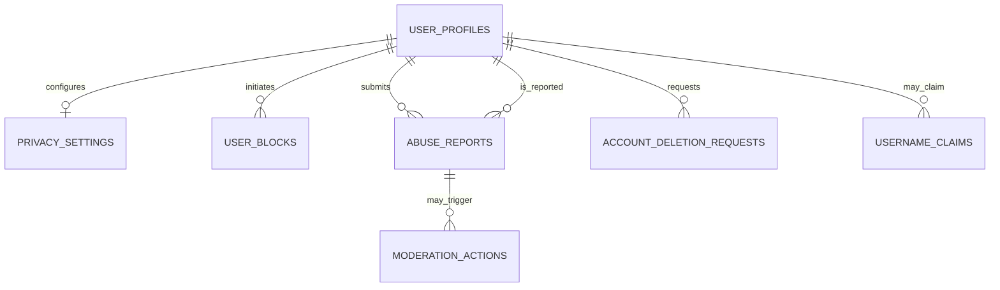

# Communication System — Backend Database Schema
**Version:** 1.0  
**Architecture:** Matrix-first + MongoDB  
**Status:** Proposed — validate during Phase 0 before implementation

## 1. Architecture Overview

The backend has two primary data layers.

| Layer | Responsibility |
|---|---|
| Matrix homeserver | Authentication integration, encrypted message events, rooms, membership, device crypto state, synchronization and protocol-level receipts |
| MongoDB | Application profiles, optional username claims, privacy settings, reports, moderation records, deletion workflows and audit events |
| Object storage | Optional future encrypted media storage |
| Push services | FCM/APNs integration, using generic notification content to protect privacy |

**Important:** Do not create a separate MongoDB `messages` collection if Matrix is the selected messaging protocol. Doing so would duplicate protocol state and create consistency and security risks.

## 2. Collections

### 2.1 `user_profiles`

Stores application-specific public profile information.

```ts
interface UserProfile {
  _id: ObjectId;
  matrixUserId: string; // Unique
  displayName: string;
  avatarUrl?: string;
  bio?: string;
  profileVisibility: "everyone" | "contacts" | "nobody";
  createdAt: Date;
  updatedAt: Date;
}
```

**Indexes**
- Unique: `matrixUserId`
- Optional: text or normalized search index if user discovery requires it.

### 2.2 `username_claims`

Use this collection only if the product needs its own username reservation system.

```ts
interface UsernameClaim {
  _id: ObjectId;
  username: string;
  normalizedUsername: string; // Unique, normalized
  matrixUserId: string;       // Unique
  createdAt: Date;
  updatedAt: Date;
}
```

**Rules**
- Normalize usernames consistently before checking uniqueness.
- Validate length, permitted characters and reserved names.
- Never rely on a pre-insert availability check alone; enforce uniqueness in the database.
- If Matrix already provides the required identifier behavior, avoid duplicating it unnecessarily.

### 2.3 `privacy_settings`

Stores settings that are not already adequately managed through Matrix account data or another authoritative store.

```ts
interface PrivacySettings {
  _id: ObjectId;
  matrixUserId: string; // Unique
  profileVisibility: "everyone" | "contacts" | "nobody";
  presenceVisibility: "everyone" | "contacts" | "nobody";
  readReceiptsEnabled: boolean;
  messagePreviewEnabled: boolean;
  discoverabilityEnabled: boolean;
  createdAt: Date;
  updatedAt: Date;
}
```

Use secure defaults and enforce privacy preferences on the server as well as in the client UI.

### 2.4 `user_blocks`

Only create this collection if application-level blocking is needed beyond the selected Matrix implementation.

```ts
interface UserBlock {
  _id: ObjectId;
  blockerMatrixUserId: string;
  blockedMatrixUserId: string;
  reason?: string;
  createdAt: Date;
}
```

**Indexes and rules**
- Unique compound index: `blockerMatrixUserId + blockedMatrixUserId`
- Prevent users from blocking themselves.
- Apply block checks consistently to messaging initiation, discovery, and other relevant interactions.
- Decide explicitly whether Matrix-level blocking or application-level blocking is authoritative.

### 2.5 `abuse_reports`

Stores reports explicitly submitted by users.

```ts
type ReportCategory =
  | "spam"
  | "harassment"
  | "impersonation"
  | "threats"
  | "other";

type ReportStatus =
  | "open"
  | "under_review"
  | "resolved"
  | "dismissed";

interface AbuseReport {
  _id: ObjectId;
  reporterMatrixUserId: string;
  reportedMatrixUserId: string;
  category: ReportCategory;
  description?: string;
  evidenceReferences?: string[];
  status: ReportStatus;
  assignedModeratorId?: string;
  resolution?: string;
  createdAt: Date;
  updatedAt: Date;
}
```

**Security rules**
- Only authorized moderation personnel can access moderation queues.
- Users may access their own reports only according to the product's disclosure policy.
- Validate evidence references and prevent arbitrary file access.
- Do not silently copy decrypted private messages into moderation storage.
- If a user voluntarily submits message evidence, clearly disclose what is shared.

### 2.6 `moderation_actions`

Records administrative actions and their rationale.

```ts
type ModerationActionType =
  | "warning"
  | "temporary_restriction"
  | "account_suspension"
  | "account_ban"
  | "report_dismissal";

interface ModerationAction {
  _id: ObjectId;
  actorId: string;
  targetMatrixUserId: string;
  actionType: ModerationActionType;
  relatedReportId?: ObjectId;
  reasonCode: string;
  internalNote?: string;
  createdAt: Date;
  expiresAt?: Date;
}
```

Require authorization, auditability and clear distinctions between temporary and permanent actions.

### 2.7 `account_deletion_requests`

Tracks the account-deletion workflow. It is not the authoritative account record.

```ts
type DeletionStatus =
  | "requested"
  | "awaiting_confirmation"
  | "processing"
  | "completed"
  | "failed"
  | "cancelled";

interface AccountDeletionRequest {
  _id: ObjectId;
  matrixUserId: string;
  status: DeletionStatus;
  requestedAt: Date;
  confirmedAt?: Date;
  completedAt?: Date;
  steps: Array<{
    name: string;
    status: "pending" | "completed" | "failed";
    errorCode?: string;
    updatedAt: Date;
  }>;
  retryCount: number;
}
```

Deletion should be an authenticated, confirmed and idempotent workflow. Define how Matrix data, application data, uploaded media, sessions and backups are handled. Clearly disclose any data that cannot be immediately erased from backups or must be retained for legal reasons.

### 2.8 `audit_events`

Records important security and administrative events without storing private message content.

```ts
interface AuditEvent {
  _id: ObjectId;
  actorType: "user" | "moderator" | "admin" | "system";
  actorId?: string;
  action: string;
  targetType?: string;
  targetId?: string;
  requestId?: string;
  outcome: "success" | "failure";
  createdAt: Date;
}
```

Never store passwords, access tokens, encryption keys or decrypted message bodies in audit logs. Restrict access and establish a retention policy.

### 2.9 `idempotency_records` — Optional

Use for application operations that must safely tolerate retries, such as creating a report or starting an account-deletion request.

```ts
interface IdempotencyRecord {
  _id: ObjectId;
  principalId: string;
  operation: string;
  idempotencyKey: string;
  requestHash: string;
  status: "processing" | "completed" | "failed";
  resultReference?: string;
  createdAt: Date;
  expiresAt: Date;
}
```

Create a unique compound index on `principalId + operation + idempotencyKey`. A TTL index may clean up expired records eventually, but correctness must not depend on exact deletion timing.

## 3. Relationship Diagram



This is a logical diagram, not a mandate to create MongoDB foreign-key constraints. Use application-level validation and appropriate indexes.

## 4. Backend API Mapping

| Method | Endpoint | Purpose |
|---|---|---|
| GET | `/api/v1/me` | Retrieve the current user's application profile |
| PATCH | `/api/v1/me` | Update permitted profile fields |
| GET | `/api/v1/users/:username` | Retrieve a discoverable public profile |
| GET | `/api/v1/me/privacy` | Read privacy settings |
| PATCH | `/api/v1/me/privacy` | Update privacy settings |
| POST | `/api/v1/reports` | Submit an abuse report |
| GET | `/api/v1/me/blocks` | List blocked users |
| POST | `/api/v1/me/blocks` | Block a user |
| DELETE | `/api/v1/me/blocks/:userId` | Unblock a user |
| POST | `/api/v1/me/deletion-requests` | Start account deletion |
| GET | `/api/v1/me/deletion-requests/:id` | Check deletion progress |

Messaging endpoints should use the supported Matrix client-server API and SDKs when Matrix is selected, rather than implementing a parallel custom messaging API.

## 5. Security and Data Integrity

1. Authenticate requests using the selected Matrix-compatible authentication flow or a carefully designed application session.
2. Enforce authorization on every protected operation; never trust a client-supplied user ID as proof of identity.
3. Validate request bodies and use strict schemas for allowed fields.
4. Use TLS for network connections and least-privilege database credentials.
5. Keep secrets in environment-specific secret management, never in source control.
6. Never upload users' private encryption keys to MongoDB.
7. Do not store passwords or plaintext private messages in application collections.
8. Apply rate limits to login-related flows, profile discovery, reports and other abuse-prone endpoints.
9. Maintain appropriate audit trails and retention limits.
10. Test account deletion, device revocation, privacy enforcement and authorization failures.

## 6. Recommended Implementation Order

1. **Phase 0:** Validate Matrix, client SDKs, licensing, hosting and deployment architecture.
2. **Phase 1:** Implement `user_profiles` and username claims only if needed.
3. **Phase 2:** Integrate Matrix authentication, device identity and encrypted direct messaging.
4. **Phase 3:** Add privacy settings and blocking where Matrix does not already provide the required behavior.
5. **Phase 4:** Implement abuse reports, moderation actions and audit events.
6. **Phase 5:** Implement and test the account-deletion workflow.
7. **Phase 6:** Add idempotency records and other operational collections only when justified.

## 7. Definition of Done

- [ ] Every collection has a documented purpose and data owner.
- [ ] Required unique and compound indexes are implemented.
- [ ] Validation and authorization tests pass.
- [ ] No duplicate Matrix message, room, or encryption-state collections exist.
- [ ] No private keys or plaintext message bodies are stored in application collections.
- [ ] Privacy settings are enforced by the backend.
- [ ] Reports and moderation data have restricted access.
- [ ] Account deletion is recoverable from transient failures and safe to retry.
- [ ] Database migrations, backups and retention policies are documented.
- [ ] Tests, linting and production builds pass before the phase is closed.

**Next recommended deliverable:** Backend API Specification — exact request and response formats, validation rules, authentication middleware, authorization policies, error codes, and Matrix integration boundaries.