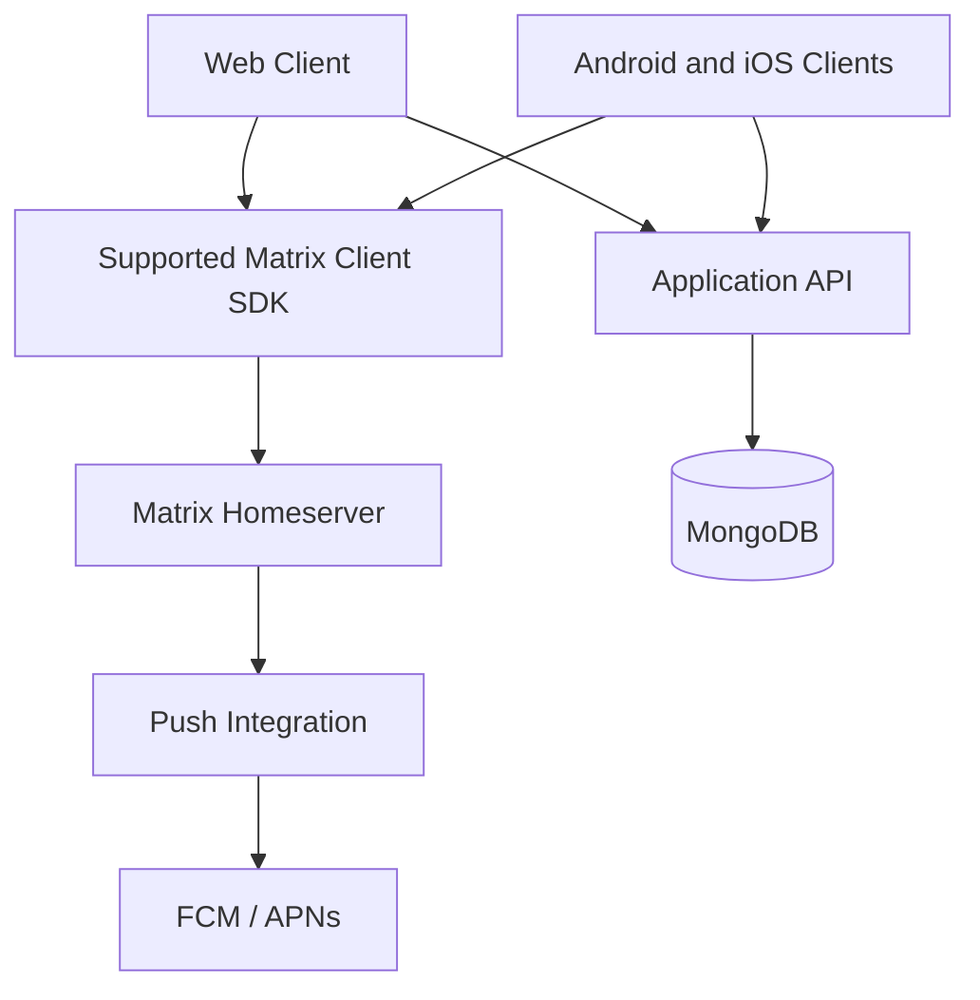

# Communication System — Implementation Plan

**Version:** 1.0  
**Status:** Proposed  
**Architecture:** Matrix-first, pending Phase 0 validation  
**Target platforms:** Web, Android, iOS  
**Estimated duration:** 16–24 weeks for a focused beta, subject to testing, SDK compatibility and available development time

---

## 1. Product Goal

Build a reliable, privacy-focused messaging application with:

- One-to-one end-to-end encrypted messaging from the first public beta.
- Web, Android and iOS clients.
- Secure account and device management.
- Real-time messaging and offline synchronization.
- Privacy controls, blocking and abuse reporting.
- Account deletion and transparent data-retention policies.
- A maintainable architecture that can support future features.

### Non-negotiable engineering rules

1. Never implement cryptographic protocols from scratch.
2. Never silently downgrade an encrypted conversation to plaintext.
3. Never store decrypted message content or private encryption keys in the application database.
4. Use Matrix as the messaging source of truth if Phase 0 confirms the architecture.
5. Every implementation phase must have tests, manual verification and a documented exit gate.
6. Do not mark a phase complete merely because the code compiles.
7. Commit working changes using Conventional Commits.
8. Do not add features outside the current phase without documenting and approving the scope change.

## 2. Proposed Technology Stack

| Layer | Proposed technology | Purpose |
|---|---|---|
| Web client | React, TypeScript, Vite | Browser application |
| Mobile clients | Capacitor wrapper around the web client (provisional, ADR-0001 C2; fallback native Kotlin/Swift on matrix-rust-sdk) | Android and iOS |
| Messaging protocol | Matrix | Encrypted events, rooms, sync and protocol state |
| Client encryption | Supported Matrix client SDK | Device keys, encryption and decryption |
| Homeserver | Synapse or another compatible implementation | Matrix protocol services |
| Application API | Node.js, TypeScript, Express | Product-specific backend features |
| Application database | MongoDB | Profiles, reports and other app-owned data |
| Media storage | Deferred; encrypted uploads only | Future media support |
| Notifications | FCM/APNs through a suitable integration | Push notifications |
| Testing | Vitest, browser/WebView end-to-end tests, API integration tests | Automated quality checks |
| CI/CD | GitHub Actions | Automated checks and build validation |
| Deployment | Managed or self-hosted services selected in Phase 0 | Hosting and operations |

**Architecture condition:** Do not commit to a particular Matrix SDK or mobile framework integration until a technical spike proves that the required encryption, device management, licensing and platform support work together.

## 3. System Architecture



The clients perform message encryption and decryption. The homeserver handles protocol operations and encrypted events. The application API manages product-specific functionality.

MongoDB must not become a second messaging database.

## 4. Phase Roadmap

<text>Each phase has a separate completion gate. Durations overlap only if explicitly approved; otherwise, finish and verify one phase before starting the next.</text>

### Phase 0 — Architecture validation and project foundation

**Estimated duration:** 1–2 weeks

**Objective:** Prove that the proposed architecture is feasible before substantial implementation begins.

**Tasks**
- Review the PRD and TRD and convert requirements into traceable tickets.
- Create an architecture decision record comparing Matrix with a custom messaging backend.
- Validate web and mobile SDK support for encryption, verification, session recovery and offline sync.
- Review SDK and server licensing, maintenance status, deployment requirements and operational costs.
- Run a small proof of concept: two accounts, two devices, an encrypted message and a successful decryption on the recipient.
- Verify that the server cannot read the ordinary message body.
- Establish the repository, environment configuration, linting, formatting, testing and CI pipeline.
- Document the threat model, data boundaries and initial deployment design.

**Deliverables**
- Approved architecture decision record (ADR).
- Working encrypted messaging proof of concept.
- Initial threat model.
- Repository structure and automated quality checks.
- Requirements-to-test traceability list.

**Exit gate**
- [ ] Web and mobile feasibility is demonstrated or platform limitations are documented and resolved.
- [ ] End-to-end encryption works without a plaintext fallback.
- [ ] Licensing and operational constraints are understood.
- [ ] CI passes on the default branch.
- [ ] Architecture decisions are recorded and reviewed.

**Commit example:** `docs(architecture): record messaging architecture decision`

---

### Phase 1 — Repository, environments and application foundation

**Estimated duration:** 1–2 weeks

**Objective:** Establish a reproducible development environment.

**Tasks**
- Set up the monorepo or clearly separated repositories.
- Configure TypeScript, ESLint, formatting, environment validation and package scripts.
- Build the initial responsive design system using the UI/UX brief.
- Configure development, test and production environment boundaries.
- Add CI checks for linting, type checking, tests and production builds.
- Add structured, privacy-safe logging and error handling.
- Document local setup and deployment procedures.

**Suggested monorepo layout**

```text
communication-system/
├── apps/
│   ├── web/
│   ├── mobile/
│   └── api/
├── packages/
│   ├── shared-types/
│   ├── validation/
│   └── design-tokens/
├── infrastructure/
├── docs/
│   ├── architecture/
│   ├── security/
│   └── runbooks/
├── .github/workflows/
├── package.json
└── README.md
```

Adjust the structure if the selected Matrix SDK requires a different build setup. Avoid extracting packages merely for the sake of abstraction.

**Exit gate**
- [ ] A new developer can follow the setup guide successfully.
- [ ] All applications start in their intended environments.
- [ ] Lint, type checks, tests and builds pass.
- [ ] Secrets are excluded from source control.
- [ ] The initial CI pipeline is green.

**Commit example:** `chore(repo): establish workspace and quality checks`

---

### Phase 2 — Identity, authentication and device security

**Estimated duration:** 2–3 weeks

**Objective:** Create a secure account and device lifecycle.

**Tasks**
- Implement the selected Matrix-compatible registration and sign-in flow.
- Create welcome, authentication, loading and error screens.
- Integrate the supported SDK's device identity and encryption initialization.
- Implement device verification and clear verification-state indicators.
- Design secure session persistence and sign-out.
- Implement device/session listing and revocation using supported protocol operations.
- Handle expired sessions, changed device identities and missing encryption keys.
- Define recovery behavior and explain its limitations to users.

**Security requirements**
- Do not store credentials or private keys in plaintext application storage.
- Use appropriate platform-secure storage for mobile secrets and a carefully reviewed web storage strategy.
- Never treat a successful login as proof that every device is trusted.
- Clearly notify users about identity changes.
- Do not implement home-grown cryptography or invent a key-recovery scheme.

**Exit gate**
- [ ] Registration and login work for valid users.
- [ ] Invalid credentials and expired sessions are handled safely.
- [ ] Device identity and verification status are visible.
- [ ] Revoking a device prevents its subsequent authorized use as designed.
- [ ] No credentials or private keys appear in logs or ordinary database records.
- [ ] Authentication, authorization and session lifecycle tests pass.

**Commit example:** `feat(auth): implement account and device lifecycle`

---

### Phase 3 — One-to-one encrypted messaging

**Estimated duration:** 3–4 weeks

**Objective:** Deliver the core messaging experience.

**Tasks**
- Implement the conversation list and new-conversation flow.
- Support direct conversations through Matrix.
- Integrate encrypted message composition and decryption.
- Implement pagination, local state management and sync.
- Show distinct pending, sent, delivered, read and failed states only when supported and meaningful.
- Add retry handling that avoids accidental duplicate messages.
- Support offline sending and later synchronization where the SDK permits.
- Display understandable errors for undecryptable messages and unverified devices.
- Add message timestamps and basic conversation details.

**Initial scope**
- Text-only direct messaging.
- No group messaging in the initial beta unless separately approved.
- No calls, bots, public channels or custom cryptographic features.
- No server-side plaintext search.

**Exit gate**
- [ ] Two separate accounts can exchange encrypted messages.
- [ ] The recipient can decrypt messages on an authorized device.
- [ ] Server-side inspection confirms ordinary message content remains encrypted.
- [ ] Reconnection and synchronization do not create unintended duplicates.
- [ ] Pagination and error states work.
- [ ] Unverified-device and undecryptable-message cases are tested.
- [ ] No plaintext fallback is possible.

**Commit example:** `feat(messaging): add encrypted direct conversations`

---

### Phase 4 — Complete the web experience

**Estimated duration:** 2–3 weeks

**Objective:** Turn the messaging prototype into a usable web application.

**Tasks**
- Complete the responsive chat layout.
- Implement profile display and supported profile editing.
- Add conversation details and device-security entry points.
- Add privacy and notification settings.
- Implement blocked-user management.
- Add loading, empty, offline and error states.
- Support keyboard navigation and accessible labels.
- Verify responsive layouts across common desktop, tablet and mobile-browser sizes.
- Test refresh, session restoration and multiple-tab behavior.

**Exit gate**
- [ ] Primary user journeys work from sign-in to encrypted conversation.
- [ ] Responsive layouts remain usable at supported viewport sizes.
- [ ] Session restoration and sign-out behave correctly.
- [ ] Keyboard and accessibility checks pass against the project's target.
- [ ] The production web build passes.
- [ ] Manual cross-browser verification is recorded.

**Commit example:** `feat(web): complete responsive messaging experience`

---

### Phase 5 — Android and iOS clients

**Estimated duration:** 3–4 weeks, subject to the device spike

**Objective:** Provide mobile clients with the same core security and messaging guarantees, as a Capacitor wrapper around the web client (ADR-0001 C2, provisional).

**Tasks**
- Run the real-device spike first (Android System WebView and iOS WKWebView): wasm crypto, key storage, session restore. If it fails, switch to native Kotlin/Swift on matrix-rust-sdk and re-estimate.
- Implement the mobile navigation and design system.
- Integrate the validated Matrix SDK and secure device storage (recovery key and session token in native secure storage via a Capacitor plugin).
- Implement authentication, device verification and encrypted messaging.
- Add conversation lists, offline states and synchronization.
- Integrate push notifications with privacy-preserving content.
- Test application backgrounding, restart, network loss and session expiry.
- Validate the Android and iOS permission and release configurations.
- Document any differences from the web experience.

**Exit gate**
- [ ] Android and iOS builds install and launch successfully.
- [ ] Encrypted direct messaging works across web and mobile.
- [ ] Device verification and session revocation work as designed.
- [ ] Push notifications do not expose message contents by default.
- [ ] Offline and reconnection flows pass manual tests.
- [ ] Platform-specific security limitations are documented, including the WebView key-storage limitation in the privacy disclosure (ADR-0001 C2a).

**Commit example:** `feat(mobile): implement secure cross-platform messaging`

---

### Phase 6 — Application backend and MongoDB

**Estimated duration:** 2–3 weeks

**Objective:** Implement only the product-specific API and database functionality.

**Tasks**
- Implement `user_profiles` and optional `username_claims`.
- Add validated profile read/update endpoints.
- Add privacy settings only where they are not already adequately managed by Matrix.
- Implement blocking where protocol functionality alone does not meet product requirements.
- Add abuse-report submission and restricted moderation access.
- Implement audit events that exclude secrets and message plaintext.
- Add the account-deletion workflow and retry-safe operations.
- Add database indexes, migrations, request validation, authorization and rate limits.
- Define backup, retention and deletion procedures.

**Important:** The API must not recreate Matrix message storage, rooms, membership, encryption state or synchronization.

**Exit gate**
- [ ] All endpoints validate input and enforce authorization.
- [ ] Required database indexes exist.
- [ ] Users cannot read or modify another user's private application data.
- [ ] Blocking and privacy settings are enforced consistently.
- [ ] Moderation data is restricted to authorized personnel.
- [ ] Account deletion is idempotent and handles partial failures.
- [ ] API integration and database tests pass.

**Commit example:** `feat(api): add profile privacy and safety endpoints`

---

### Phase 7 — Security hardening and reliability

**Estimated duration:** 2–3 weeks

**Objective:** Identify and fix high-impact failures before inviting beta users.

**Tasks**
- Review the threat model and trust boundaries.
- Audit dependencies and update vulnerable packages.
- Test access control, rate limiting and abuse resistance.
- Test device revocation, key loss, verification changes and recovery.
- Verify secure secret handling and production configuration.
- Review logging, monitoring and error reporting for sensitive data leakage.
- Test account deletion across application-owned data and Matrix-related data.
- Test backup and restore procedures.
- Perform dependency and configuration scans; arrange specialist security review where feasible.

**Exit gate**
- [ ] No known unresolved critical or high-severity security issue remains without explicit risk acceptance.
- [ ] Encryption and device lifecycle scenarios pass.
- [ ] Authorization and abuse-control tests pass.
- [ ] Monitoring and incident-response procedures are documented.
- [ ] Backup and restore have been exercised.
- [ ] Data-retention and deletion behavior has been tested and documented.

**Commit example:** `test(security): harden device and account lifecycle`

---

### Phase 8 — Closed beta and release readiness

**Estimated duration:** 1–2 weeks

**Objective:** Validate the product with a small, controlled group.

**Tasks**
- Deploy to a staging environment.
- Test end-to-end flows on real devices and browsers.
- Invite a small number of testers.
- Collect opt-in, privacy-safe diagnostic feedback.
- Measure crashes, message failures, sync delays and authentication failures.
- Triage issues and release fixes through the same phase gates.
- Prepare user documentation, privacy disclosures and support procedures.
- Establish rollback and incident-response procedures before wider access.

**Exit gate**
- [ ] No unresolved release-blocking issue remains.
- [ ] Core journeys pass on supported platforms.
- [ ] Encryption and device verification behavior is understood by testers.
- [ ] Privacy disclosures match actual system behavior.
- [ ] Deployment, monitoring, backups and rollback procedures are ready.
- [ ] Beta acceptance criteria and known limitations are published.

**Commit example:** `release(beta): prepare controlled messaging beta`

---

## 5. Recommended Weekly Sequence

| Period | Primary focus | Milestone |
|---|---|---|
| Weeks 1–2 | Phase 0 | Architecture and encryption proof of concept |
| Weeks 3–4 | Phase 1 | Repository and CI foundation |
| Weeks 5–7 | Phase 2 | Account and device security |
| Weeks 8–11 | Phase 3 | Encrypted direct messaging |
| Weeks 12–14 | Phase 4 | Complete web client |
| Weeks 15–18 | Phase 5 | Mobile clients |
| Weeks 19–21 | Phase 6 | Application backend |
| Weeks 22–24 | Phases 7–8 | Security hardening and closed beta |

These are planning estimates, not guaranteed deadlines. If SDK compatibility, security testing or mobile integration takes longer, extend the schedule instead of weakening the security requirements.

## 6. Development Workflow for Every Task

Follow the same loop for every ticket.

1. **Define:** Write the requirement, acceptance criteria and relevant threat considerations.
2. **Inspect:** Review existing code and architecture decisions before changing anything.
3. **Implement:** Make the smallest coherent change.
4. **Test:** Add or update unit, integration or end-to-end tests.
5. **Verify:** Run linting, type checks, tests and production builds.
6. **Review:** Inspect the diff for secrets, unsafe defaults, accidental scope expansion and regressions.
7. **Manually test:** Follow the relevant checklist on the actual target platform.
8. **Document:** Record results, known limitations and any manual deployment steps.
9. **Commit:** Use a descriptive Conventional Commit.
10. **Gate:** Mark the ticket complete only when its acceptance criteria pass.

### Standard verification commands

Adapt these to the selected package manager and repository scripts.

```bash
# Install dependencies from the lockfile
pnpm install --frozen-lockfile

# Static quality checks
pnpm lint
pnpm typecheck

# Automated tests
pnpm test

# Production build
pnpm build
```

If a check is not configured for a particular application, document that limitation and add the check before declaring the relevant foundation phase complete.

### Conventional Commit examples

- `docs(architecture): record Matrix integration decision`
- `chore(repo): configure TypeScript and CI`
- `feat(auth): add secure sign-in flow`
- `feat(messaging): implement encrypted direct chat`
- `test(api): cover profile authorization`
- `fix(sync): handle reconnect without duplicate messages`
- `docs(security): document account deletion behavior`

## 7. Release Definition of Done

The beta is not ready until all applicable items are satisfied.

- [ ] Web, Android and iOS clients can exchange encrypted direct messages.
- [ ] The selected Matrix implementation and SDKs have passed compatibility and licensing review.
- [ ] Device identity and verification states are understandable to users.
- [ ] No custom cryptographic implementation or silent plaintext fallback exists.
- [ ] Profile, privacy, blocking and reporting flows work.
- [ ] Device/session revocation is tested.
- [ ] Account deletion behavior and retention limitations are documented.
- [ ] Security-sensitive data is excluded from logs and application database records.
- [ ] Automated checks and production builds pass.
- [ ] A closed beta has completed its acceptance process.
- [ ] Operational monitoring, backups and incident-response procedures are documented.

## 8. What to Build First

The immediate next milestone is **Phase 0, not the full messaging UI**.

Create the repository and a minimal proof of concept that demonstrates:

1. Two separate Matrix accounts can sign in.
2. A client can establish and verify device identity.
3. One client sends an encrypted direct message.
4. The recipient decrypts it successfully.
5. The homeserver stores the encrypted event without receiving the ordinary message body in plaintext.
6. The clients recover correctly from a network interruption.
7. The web and mobile SDK choices are viable for the required security behavior.

Only after this proof passes should the project commit to the complete architecture and proceed to the next phase.

**Project principle:** build the smallest secure foundation first, prove it works, and then expand it into a polished cross-platform product.