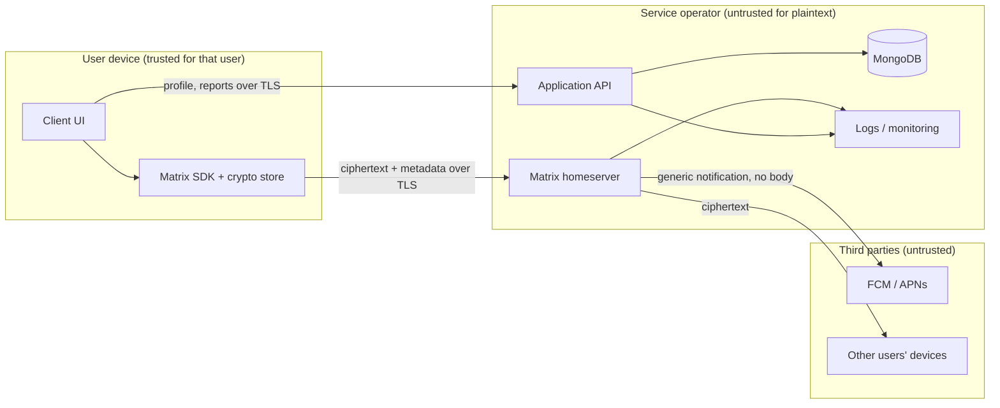

# Threat Model — Baseline

**Version:** 0.1 (Phase 0 baseline)  
**Status:** Baseline v0.1 — updated with Phase 0 PoC results (runs c53fc0cd and 77a2f5ca, 2026-10-20)  
**Owner:** Project owner  
**Review trigger:** Any change to the messaging protocol, SDK, authentication model, key storage, recovery design, or deployment topology.

This document records what the system protects, from whom, and what it explicitly does not protect. It is written against the Matrix-first architecture evaluated in [ADR-0001](../architecture/ADR-0001-messaging-architecture.md). Each row traces to the TRD (sections 3.3, 6, 10.4) or AGENTS.md section 6.

---

## 1. Assets

| Asset | Classification | Where it lives |
|---|---|---|
| Private message plaintext | Confidential, user-owned | Only on authorized client devices, in memory and in the client's local store |
| Device private keys (identity, one-time, Megolm sessions) | Secret, device-owned | Client crypto store only (IndexedDB on web; platform secure storage plus SDK store on mobile) |
| Cross-signing private keys and recovery key | Secret, user-owned | Client; optionally in server-side **encrypted** secret storage under a user-held passphrase or key |
| Access tokens and refresh tokens | Secret | Client session store; homeserver token table |
| Account credentials (password hash) | Secret | Homeserver only |
| Device public keys and signatures | Public, integrity-sensitive | Homeserver, published to peers |
| Room membership and DM routing | Metadata, sensitive | Homeserver |
| Encrypted events (ciphertext, sender, timestamp, size) | Metadata, sensitive | Homeserver event store |
| Application profile data | Public or user-controlled | MongoDB `user_profiles` |
| Abuse reports and user-submitted evidence | Confidential, restricted | MongoDB `abuse_reports` |
| Push tokens | Sensitive | Homeserver pusher table and push gateway |
| Operational and audit logs | Sensitive | Server logs, MongoDB `audit_events` |

## 2. Trust boundaries

Boundary rules:

1. **Plaintext never crosses the device boundary.** The homeserver, application API, MongoDB, logs and push providers only ever see ciphertext and metadata.
2. **Private key material never crosses the device boundary unencrypted.** The only permitted server-side copy is Matrix secret storage, which is encrypted client-side with a user-held key.
3. **The application API is not a messaging path.** It owns profiles, privacy settings, reports, moderation and the deletion workflow only (see `docs/BACKEND_SCHEMA.md`). It never receives, stores or proxies message events.
4. **Identity is per device, not per account.** Logging in proves account control; it does not make a device trusted to peers. Trust is established by device verification (cross-signing or SAS).

## 3. Threat actors

| Actor | Capability | Goal |
|---|---|---|
| T1 Malicious or compromised server operator | Full read/write on homeserver DB, logs, TLS termination, MongoDB | Read messages, impersonate users, inject devices |
| T2 Network attacker | Observe or tamper with traffic | Read or alter messages, steal tokens |
| T3 Compromised user device | Full access to one device's storage and memory | Read that device's history, send as the user |
| T4 Account takeover (credential theft, phishing) | Can log in as the user and register new devices | Read future messages, impersonate |
| T5 Malicious conversation participant | Legitimate peer | Harass, spam, leak, impersonate via screenshots |
| T6 Impersonation / device-key substitution | Operator or MITM injects a fake device for a user | Decrypt messages addressed to the victim |
| T7 Lost or stolen device | Physical access, possibly unlocked | Read local history, continue session |
| T8 Malicious browser script or dependency | Runs in the web app origin | Exfiltrate keys, plaintext or tokens |
| T9 Push provider | Receives notification payloads | Learn message content or metadata |
| T10 Spam / abusive registration | Unlimited accounts | Harassment, resource exhaustion |
| T11 Denial of service | Traffic flood | Availability loss |
| T12 Backup / recovery compromise | Access to server backups or the user's recovery key | Decrypt history, restore deleted data |

## 4. Threats, mitigations and status

Status legend (AGENTS.md §12 labels in bold where applicable): **Verified** (exercised and passed in the Phase 0 PoC, see `poc/matrix-e2ee/RESULTS.md`), **Protocol** (provided by Matrix and the SDK when used correctly, not yet exercised), **Planned (N)** (to be implemented and tested in phase N), **Accepted** (residual risk, documented), **Open** (decision needed).

| ID | Threat | Mitigation | Status |
|---|---|---|---|
| TM-01 | T1 reads message bodies from the DB | Olm/Megolm E2EE via the Rust crypto SDK; server stores `m.room.encrypted` only. Direct SQLite read: 0 plaintext message events, nonce absent from the whole DB file. | **Verified** |
| TM-02 | T1 reads message bodies from logs | Homeserver never receives plaintext (nonce absent from the Synapse log in the PoC); app logs exclude event content; log review in Phase 7 | **Verified** (homeserver log) + Planned (7) (app logs) |
| TM-03 | T1 or T6 injects a rogue device to receive keys | Cross-signing; device list shows Verified only from SDK state; own-device SAS verification; notices when a device is added or the master key is replaced; room-level "block unverified devices" evaluated in Phase 3 | **Verified** (own devices: SAS completes → verified, mismatch → unverified; new-device and identity-change notices) + Planned (3) (other users' devices in UI, room-level policy) |
| TM-04 | T1 silently downgrades a room to plaintext | SDK refuses to send into an encrypted room without a crypto backend ("your client does not support encryption"); an encryption error leaves the event local as `not_sent`; server event count unchanged. Client-side state check before send still to be added in the app. | **Verified** (SDK behaviour) + Planned (3) (app guard) |
| TM-05 | T2 reads or alters traffic | TLS 1.2+ in production; HSTS; certificate pinning evaluated for mobile | Planned (7) |
| TM-06 | T2 or T4 steals an access token | Tokens only in the app's IndexedDB session store; refresh tokens with 5-minute access tokens (Synapse), refreshed by the app; a used refresh token cannot be replayed; revocation via device delete; tokens scrubbed from logs | **Verified** (integration: expiry → soft logout → refresh; replay rejected; logout → `M_UNKNOWN_TOKEN`; logger tests) |
| TM-07 | T3 reads local history | Out of scope for E2EE; platform encryption-at-rest; app lock evaluated post-MVP | Accepted (disclosed to users) |
| TM-08 | T4 registers a new device after credential theft | Device list with verification state; "new device signed in" notice on existing sessions; revoke from another device with password re-authentication; MFA evaluated before public release | **Verified** (integration + manual two-origin check) + Planned (7) (MFA) |
| TM-09 | T5 leaks messages via screenshot or forwarding | Cannot be prevented; stated in the privacy disclosure | Accepted |
| TM-10 | T7 attacker uses a stolen unlocked device | Remote device revocation from another session; revocation stops future sync but cannot erase already-downloaded content (TRD 5.3, stated in the dialog). A revoked device observes a hard logout, lands on sign-in and its session, sync and crypto stores are deleted (the per-device crypto prefix must be passed to the SDK; a defect here was found and fixed in Phase 2). | **Verified** (self-logout, remote revocation, store wipe) |
| TM-11 | T8 script in the web origin exfiltrates keys or plaintext | Strict CSP, no inline scripts, dependency lockfile and audit, no third-party analytics scripts; session and keys live in origin-scoped IndexedDB (ADR-0003 D2), never `localStorage`; limitation stated in the privacy notes | Implemented (2: storage strategy, dev CSP, disclosure) + Planned (4, 7) (production CSP and headers) |
| TM-12 | T9 learns content from push | Push payloads are generic (`event_id_only` format); the client fetches and decrypts after wake | Planned (5) |
| TM-13 | T10 abusive registrations | Registration rate limits; registration token or invite-only beta; optional email verification | Planned (2, 7); Open: invite-only vs open |
| TM-14 | T11 flooding | Homeserver rate limiting, reverse-proxy limits, application API rate limits | Planned (7) |
| TM-15 | T12 server backup exposes history | Backups contain ciphertext only; DB and backups encrypted at rest; the secret-storage recovery key is user-held and never on the server in plaintext | Planned (7) |
| TM-16 | T12 user loses the recovery key | Encrypted history is unrecoverable by design; the setup screen and the sign-in recovery note say so (PRD 10.4); key backup lets a device with the key restore history | Accepted; **disclosed in the UI** |
| TM-17 | Moderators read private messages | No server-side decryption capability exists; reports carry only user-submitted evidence with explicit consent | Protocol + Planned (6) |
| TM-18 | T1 reads metadata (who talks to whom, when, how much) | Not protected by E2EE; disclosed in the privacy policy; federation disabled to limit exposure | Accepted; disclosed |
| TM-19 | Compromised dependency in the crypto path | Only matrix-js-sdk / matrix-rust-sdk (Apache-2.0, actively maintained); versions pinned in the lockfile; `pnpm audit` in CI | Planned (1) |
| TM-20 | Duplicate sends on retry cause confusion or replay | Matrix transaction IDs make sends idempotent: the client refuses to enqueue a known txnId and the server returned the same `event_id` for a replayed request; a device that reconnected after an outage held exactly one copy. | **Verified**; retested in Phase 3 |
| TM-22 | Mobile client cannot use the vetted crypto stack and tempts a weaker substitute | No alternative crypto is permitted (AGENTS.md §6). React Native + wasm crypto ruled out (Hermes WebAssembly is a non-production preview). Proposed: Capacitor wrapper running the same matrix-js-sdk + wasm stack; fallback native Kotlin/Swift on matrix-rust-sdk. See `docs/architecture/MOBILE_SPIKE.md`. | Researched; **Blocked** on device spike (open risk R1) |
| TM-23 | T3/T7 on mobile: crypto keys live in the WebView's IndexedDB inside the app sandbox (Capacitor option), without hardware-backed key protection; push handlers outside the WebView cannot decrypt | App-sandboxed storage with OS file encryption; recovery key and session token in native secure storage (Keystore/Keychain) via plugin; app-lock evaluated; push stays generic (FR-09). Limitation disclosed to users. | Planned (5); **untested** |
| TM-21 | A device added after a message was sent reads old history | Megolm keys are shared only with devices present at encryption time; a late device failed with `HISTORICAL_MESSAGE_NO_KEY_BACKUP` and saw ciphertext only. With key backup (Phase 2), a device that restores with the recovery key can read backed-up history: that is the intended recovery path, gated by the user-held key. | **Verified** |
| TM-24 | T4 obtains the recovery key (shown once in the browser; the user copies or downloads it) | Generated client-side, displayed once, never persisted by the app, cleared from memory after setup; the user is told to store it outside the browser; a device restored with a stolen key still appears in the device list as a new device (TM-08) and can be revoked. Residual risk: with the key and the password an attacker restores history on their own device. | Accepted; disclosed; mitigated by TM-08 |
| TM-25 | T7 or T4 with an unlocked session removes the owner's other devices or publishes new cross-signing keys | Device deletion and cross-signing key upload require User-Interactive Auth with the password; the password is sent once and never kept; cancelling the prompt changes nothing. | **Verified** (integration: cancelled prompt leaves the device; revoke needs the password) |

## 5. Server data visibility (TRD 6.2)

Even with E2EE working, the homeserver sees (confirmed by reading the Synapse database and log in the PoC; see RESULTS.md §7):

- Matrix user IDs, device IDs, device public keys and signatures.
- Room IDs, membership, who created a DM with whom, and when.
- Event timestamps, ciphertext size, sender, and the encryption algorithm name.
- IP addresses, user agents, connection times, sync cadence.
- Push tokens (pusher registrations) and whether a device has unread events.
- Read receipts and typing notifications (metadata, not content).
- Account data that is not encrypted (room tags, direct-chat map).

The product must not claim that metadata is end-to-end encrypted.

## 6. Explicitly out of scope for the MVP

- Anonymity or hiding who communicates with whom.
- Protection against a fully compromised endpoint.
- Protection against a malicious peer who copies messages.
- Deniability guarantees beyond what the protocol provides.
- Post-compromise recovery of a device whose keys were exfiltrated, beyond revoking it.

## 7. Open decisions affecting this model

| # | Decision | Impact | Owner | Target |
|---|---|---|---|---|
| 1 | Single-device vs multi-device at launch | Multi-device requires cross-signing and key-sharing UX in Phase 2 | Owner | Phase 2 start |
| 2 | Secret storage / key backup enabled at launch | Without it a lost device loses history; with it a recovery-key UX is required | Owner | Phase 2 |
| 3 | Invite-only beta vs open registration | Changes the TM-13 mitigation | Owner | Phase 8 |
| 4 | Federation disabled (recommended) | Enabling widens T1 to other servers' operators | Owner | Phase 0 (recommend: disabled) |
| 5 | Web key-storage posture | IndexedDB is script-accessible within the origin; CSP is the main control | Owner | Phase 1 |

## 8. Change history

| Date | Change |
|---|---|
| 2026-10-20 | Initial baseline written during Phase 0 alongside ADR-0001. |
| 2026-10-20 | TM-01, TM-02, TM-04, TM-10, TM-20, TM-21 updated to Verified from PoC runs c53fc0cd and 77a2f5ca; TM-22 added. |
| 2026-10-23 | Phase 2: TM-03, TM-06, TM-08, TM-10 Verified for the web client (unit, integration against Synapse 1.163.1, manual two-origin check); TM-11 and TM-16 updated; TM-24 (recovery key exposure) and TM-25 (UIA re-authentication) added. Defect found and fixed: crypto store survived hard logout. |
| 2026-10-20 | TM-22 updated with the mobile spike outcome; TM-23 added for WebView-resident keys in the proposed Capacitor wrapper. |
